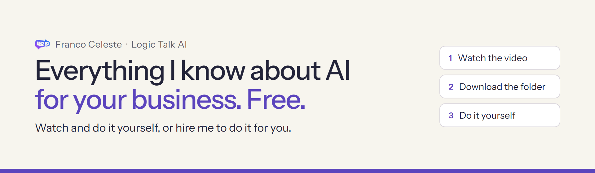

<picture>
  <source media="(prefers-color-scheme: dark)" srcset="https://raw.githubusercontent.com/FrancoCelesteAI/.github/main/profile/header-dark.png">
  
</picture>

## I'm Franco Celeste. I'm not a developer, and I run an AI company.

Each video on my channel takes one real business problem and shows the full fix on screen: the tools, the steps, the cost, and what went wrong. The files I use in the video go here, free, so you can repeat it in your own business.

You do not need to be technical.

| Watch | Do it yourself | Have it done |
|---|---|---|
| **[YouTube: @FrancoCelesteAI](https://www.youtube.com/@FrancoCelesteAI)** | **[Follow-along files](https://github.com/FrancoCelesteAI/follow-along-repo)** | **[Logic Talk AI](https://logictalk.ai/)** |
| One business problem per video, start to finish. | The prompts, example data and steps from each video. | 1:1 sessions, custom projects and done-for-you builds. |

## The builds

| # | What you build | Files |
|---|---|---|
| 01 | A one-page website for a small business, with a section that answers the questions customers ask every day | [01-website-in-one-sitting](https://github.com/FrancoCelesteAI/follow-along-repo/tree/main/01-website-in-one-sitting) |

A new folder arrives with each video.

## New here? Start in 2 minutes

1. Open the [follow-along files](https://github.com/FrancoCelesteAI/follow-along-repo) and pick a folder.
2. Open its `business-facts.md` and `PROMPTS.md`.
3. In any AI chat (Claude, ChatGPT, Gemini), paste the facts, then paste Prompt 1.

Want the AI to build real files on your computer, the way it does in the video? That needs the Claude desktop app and a paid Claude plan. [SETUP.md](https://github.com/FrancoCelesteAI/follow-along-repo/blob/main/SETUP.md) walks you through it once, in about 10 minutes.

## Rather have it done?

Everything here is free to copy. If you'd rather have someone do it, or want 1:1 help learning it, [book a free call](https://calendly.com/franco-logictalk/free-ai-diagnosis?utm_source=github&utm_medium=profile).

Every business in these files is made up. Nothing here is legal, financial or tax advice. AI tools make mistakes, and results vary.
